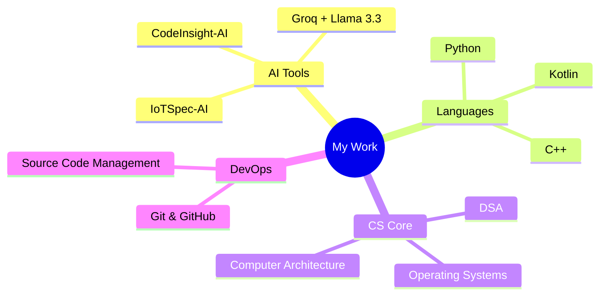

<!-- GitHub Profile README -->
<!-- Repo must be named after the username so GitHub displays it on the profile page. No personal details are included. -->

<div align="center">


[](https://github.com/Mahnoor-Farrukh)

</div>

---

## 👩‍💻 About Me

```text
🤖  Interested in AI, IoT & Smart Home Systems, and Developer Tools
🔭  Currently building AI-powered summarizers and code reviewers
🌱  Currently learning DevOps, Git & GitHub workflows
💬  Ask me about Python, Kotlin, C++, and AI APIs
```

I love turning ideas into real, working software — from systems and algorithms projects, to AI tools that summarize requirements and review code.

---

## 🚀 Featured Projects

<div align="center">

| Project | What it does | Built with |
|---|---|---|
| **[IoTSpec-AI](https://github.com/Mahnoor-Farrukh/IoTSpec-AI)** | AI-powered Requirement Summarizer for IoT and Smart Home Systems | `Kotlin` |
| **[HomeSync-AI](https://github.com/Mahnoor-Farrukh/HomeSync-AI)** | Smart Home companion project | `Kotlin` |
| **[CodeInsight-AI](https://github.com/Mahnoor-Farrukh/CodeInsight-AI)** | AI-powered code reviewer | `Python` · `Groq API` · `Llama 3.3` |
| **[MediSafetyAgent](https://github.com/Mahnoor-Farrukh/MediSafetyAgent)** | AI agent project for medical safety | `Python` |
| **[DevOps-Deliverable-1](https://github.com/Mahnoor-Farrukh/DevOps-Deliverable-1)** | Source Code Management with GitHub — Project Deliverable 1 | `C++` · `Git` · `GitHub` |

</div>

### 📚 More Projects & Experiments

- **[DSA-Lab](https://github.com/Mahnoor-Farrukh/DSA-Lab)** — Data Structures & Algorithms `C++`
- **[OS-Lab](https://github.com/Mahnoor-Farrukh/OS-Lab)** — Operating Systems
- **[CA-Lab](https://github.com/Mahnoor-Farrukh/CA-Lab)** — Computer Architecture
- **[Compiler-Construction-Lab](https://github.com/Mahnoor-Farrukh/Compiler-Construction-Lab)** — Compiler Construction
- **[Web-App-Development](https://github.com/Mahnoor-Farrukh/Web-App-Development)** — Web applications `HTML`
- **[jenkins-docker-demo](https://github.com/Mahnoor-Farrukh/jenkins-docker-demo)** — Jenkins + Docker CI demo `Dockerfile`
- **[Devops](https://github.com/Mahnoor-Farrukh/Devops)** — DevOps learning journey

---

## 🛠️ Tech Stack

<div align="center">


</div>



---

## 📊 GitHub Stats

<div align="center">


</div>

---

## 🌱 What I'm Working Towards

- Building more end-to-end AI projects and documenting them well
- Getting confident with DevOps pipelines and collaboration workflows
- Building a portfolio of projects I'm proud to share

---

<div align="center">

### 📫 Connect

[](https://github.com/Mahnoor-Farrukh)


*“Showcasing my work, one commit at a time.”*

</div>
